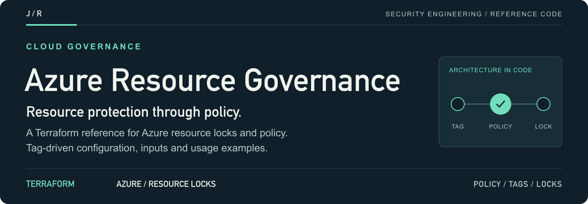
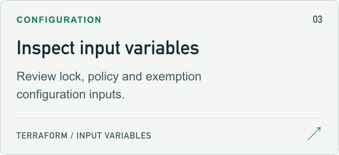
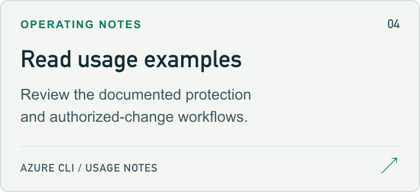

<a id="azure-resource-lock-governance"></a>

<a href="#setup-guide">
<picture>
  <source media="(max-width: 600px)" srcset="docs/assets/readme/header-mobile.png">
  
</picture>
</a>

<p>
  <a href="#setup-guide"><strong>Start here ↗</strong></a> &nbsp; / &nbsp;
  <a href="main.tf">Source</a> &nbsp; / &nbsp;
  <a href="#project-guide">Project guide</a> &nbsp; / &nbsp;
  <a href="https://github.com/jmragsdale">Profile</a>
</p>

A Terraform reference for Azure Resource Locks and policy-based configuration, with usage examples and input definitions.

## Explore the project

Open a card for source, examples or supporting documentation.

<p>
<a href="#architecture-guide">
<picture>
  <source media="(prefers-color-scheme: dark)" srcset="docs/assets/readme/architecture-dark.png">
  
</picture>
</a>
<a href="main.tf">
<picture>
  <source media="(prefers-color-scheme: dark)" srcset="docs/assets/readme/source-dark.png">
  
</picture>
</a>
<a href="variables.tf">
<picture>
  <source media="(prefers-color-scheme: dark)" srcset="docs/assets/readme/inputs-dark.png">
  
</picture>
</a>
<a href="#usage-guide">
<picture>
  <source media="(prefers-color-scheme: dark)" srcset="docs/assets/readme/usage-dark.png">
  
</picture>
</a>
</p>

## Project guide

🛡️ Automated resource protection using Azure Resource Locks with policy-driven enforcement via Terraform

## Overview

This project implements governance controls using Azure Resource Locks to prevent accidental deletion or modification of critical resources. It uses Azure Policy to automatically apply locks to resources based on tags, ensuring compliance across your subscription.

### Security Features

- **Automatic lock enforcement** via Azure Policy
- **Tag-based lock assignment** (tag resources with `Protected=true`)
- **CanNotDelete locks** prevent accidental resource deletion
- **ReadOnly locks** for immutable resources (optional)
- **Audit logging** for lock operations
- **Exemption support** for break-glass scenarios

<a id="architecture-guide"></a>

## Architecture

<details>
<summary>Architecture flow (text)</summary>

```
┌─────────────────────────────────────────────────────────────────┐
│                      Azure Subscription                         │
│                                                                 │
│  ┌──────────────────────────────────────────────────────────┐   │
│  │                    Azure Policy                          │   │
│  │  "Auto-apply CanNotDelete lock when Protected=true"      │   │
│  └──────────────────────────┬───────────────────────────────┘   │
│                             │                                   │
│         ┌───────────────────┼───────────────────┐               │
│         │                   │                   │               │
│         ▼                   ▼                   ▼               │
│  ┌─────────────┐    ┌─────────────┐    ┌─────────────┐          │
│  │  Resource   │    │  Resource   │    │  Resource   │          │
│  │  Group A    │    │  Group B    │    │  Group C    │          │
│  │             │    │             │    │             │          │
│  │ Protected=  │    │ Protected=  │    │ (no tag)    │          │
│  │   true      │    │   true      │    │             │          │
│  │   🔒        │    │   🔒        │    │            │           │
│  └─────────────┘    └─────────────┘    └─────────────┘          │
│                                                                 │
│  ┌──────────────────────────────────────────────────────────┐   │
│  │              Activity Log (Audit Trail)                  │   │
│  │  Lock Created | Lock Deleted | Policy Evaluated          │   │
│  └──────────────────────────────────────────────────────────┘   │
└─────────────────────────────────────────────────────────────────┘
```

</details>

## Prerequisites

- Azure CLI configured (`az login`)
- Terraform >= 1.0
- Contributor + User Access Administrator role (or Owner)

<a id="setup-guide"></a>

## Quick Start

```bash
# Clone the repository
git clone https://github.com/jmragsdale/az-resource-lock-governance.git
cd az-resource-lock-governance

# Login to Azure
az login

# Initialize Terraform
terraform init

# Review the plan
terraform plan

# Apply the configuration
terraform apply
```

## How It Works

1. **Deploy the Policy**: Terraform creates an Azure Policy that monitors for the `Protected` tag
2. **Tag Your Resources**: Add `Protected = "true"` tag to any resource or resource group
3. **Automatic Lock**: Azure Policy automatically applies a CanNotDelete lock
4. **Protection Active**: Resources cannot be deleted until the lock is removed

<a id="usage-guide"></a>

## Usage Examples

### Protect a Resource Group
```bash
# Using Azure CLI
az group update --name my-critical-rg --tags Protected=true

# Using Terraform
resource "azurerm_resource_group" "critical" {
  name     = "my-critical-rg"
  location = "eastus"
  
  tags = {
    Protected = "true"
  }
}
```

### Check Lock Status
```bash
# List all locks in a resource group
az lock list --resource-group my-critical-rg

# View policy compliance
az policy state list --policy-assignment resource-lock-policy
```

### Remove Protection (for authorized changes)
```bash
# Remove the lock first
az lock delete --name CanNotDelete-Lock --resource-group my-critical-rg

# Then remove the tag to prevent re-application
az group update --name my-critical-rg --tags Protected=false
```

## Configuration

| Variable | Description | Default |
|----------|-------------|---------|
| `location` | Azure region for resources | `eastus` |
| `project_name` | Project name for resource naming | `resource-lock-governance` |
| `lock_level` | Lock level (CanNotDelete or ReadOnly) | `CanNotDelete` |
| `enable_policy` | Enable automatic policy enforcement | `true` |
| `exempt_resource_groups` | Resource groups exempt from policy | `[]` |

## Outputs

| Output | Description |
|--------|-------------|
| `policy_definition_id` | ID of the custom policy definition |
| `policy_assignment_id` | ID of the policy assignment |
| `demo_resource_group_id` | ID of the demo protected resource group |
| `lock_id` | ID of the applied management lock |

## Compliance

This solution helps meet:
- **SOX Section 404**: Control over changes to production systems
- **NIST 800-53 CM-3**: Configuration change control
- **CIS Azure 8.5**: Ensure resource locks are set for mission-critical resources
- **ISO 27001 A.12.1.2**: Change management

## Best Practices

1. **Production Resources**: Always apply `Protected=true` to production databases, storage accounts, and key vaults
2. **Break-Glass Process**: Document the process for authorized lock removal
3. **Audit Regularly**: Review Activity Logs for lock operations
4. **Test First**: Test lock behavior in non-production before applying to critical resources

## Clean Up

```bash
# Remove policy assignment first
terraform destroy -target=azurerm_subscription_policy_assignment.lock_protected_resources

# Then destroy remaining resources
terraform destroy
```

## License

Apache 2.0

## Author

Jermaine Ragsdale - Cloud Security Architect

<details>
<summary>README visual assets</summary>

[Artwork sources and regeneration notes](docs/assets/readme/README.md).

</details>
